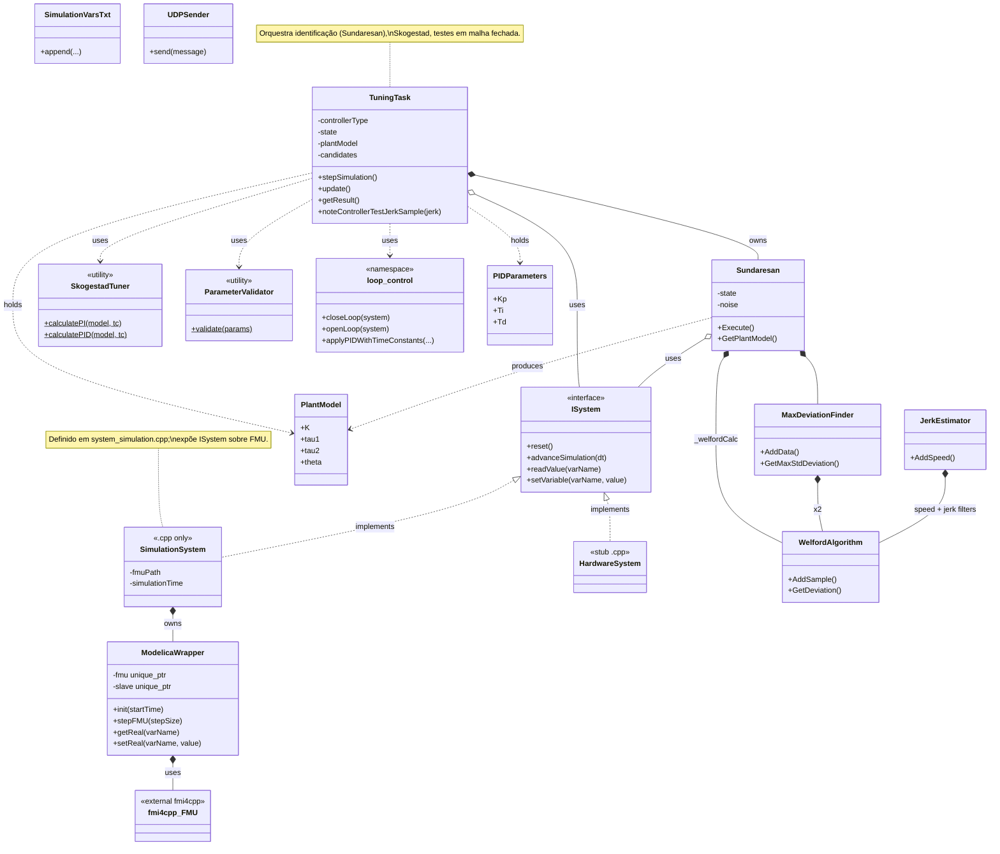
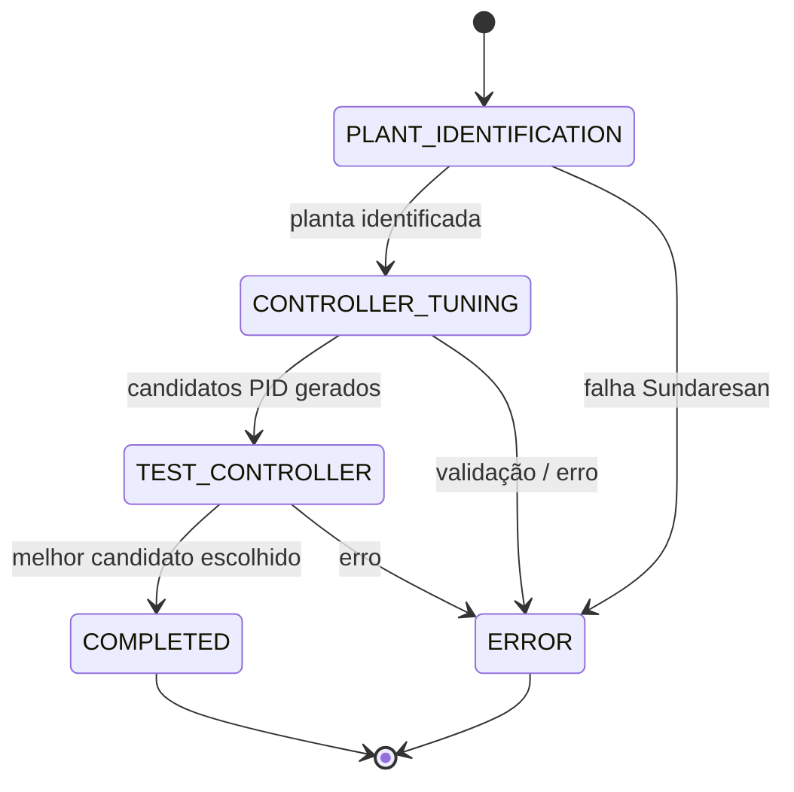
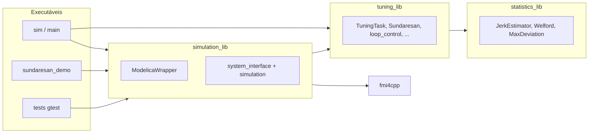

# Autotuning — UML (Mermaid)

Abre este ficheiro no Cursor/VS Code (pré-visualização Markdown com suporte Mermaid) ou cola cada bloco em [mermaid.live](https://mermaid.live) → **Actions** → exportar PNG/SVG.

## Diagrama de classes

## Estados do `TuningTask` (`TuningState`)

## Componentes (CMake / camadas)

